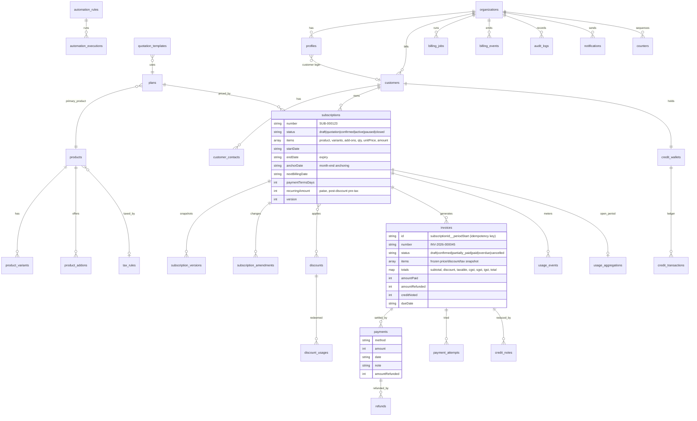

# Data model (Firestore collections)

Every document has `id`, `orgId`, `createdAt`, `updatedAt` (and `_search` tokens where searchable). Money = integer paise. `*_items` tables from a relational design are stored as **embedded arrays** (`subscription.items`, `invoice.items`, `quotation_template.items`) — the Firestore idiom, and it makes each invoice an atomic immutable snapshot. Quotations are subscriptions in `draft`/`quotation` status (Odoo-style), created from `quotation_templates`.

Other collections: `tax_rules` (rateBp, kind GST/NONE, HSN/SAC, isDefault), `discounts` (type, value, scope, productIds, minQuantity, minAmount, start/end, usageLimit, usedCount), `plans` (pricingModel flat/per_seat/tiered/volume, tiers, interval, intervalCount, minQuantity, availability, termPeriods, autoClose/closable/pausable/renewable, public), `billing_jobs_locks` (runner lock), `local_auth` + `password_resets` (local mode only).
